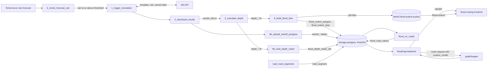

# T3 digital twin: flood-aware routing for Hanoi

This repository runs a flood digital twin for a rectangle of Hanoi. Every 15 minutes it checks a
rain forecast. When enough rain is coming, it runs a 3Di flood simulation, turns the result into
flood-depth maps, and loads the depth on every road piece into PostGIS. A routing service reads
those depths and sends people around roads that are too deep for their vehicle.

The engineering record lives in the Obsidian vault under `artifacts/`. Start at
[`artifacts/Home.md`](artifacts/Home.md) for logs, plans, concept pages, and blockers. This README
gives the overview and links to the concept pages for depth.

## How a forecast becomes a route

One Airflow DAG, `flood_mapping_full` in `dags/flood_mapping_dag.py`, produces all flood data. Two
services read it. `floodmap-backend` answers routing and depth questions from PostGIS, and the
frontend draws flood-extent tiles from MinIO.



The following sections walk through each stage in order.

### The rain gate decides whether a cycle runs

`flood_mapping_full` runs on the cron schedule `*/15 * * * *`, with `catchup=False` and
`max_active_runs=2`. A run can take about 15 minutes, so the next run may start before the last
one ends. Each run writes to its own folders, so two runs do not share files.

The first task, `0_check_forecast_rain`, asks Tomorrow.io for a forecast of
`FLOOD_RAIN_LOOKAHEAD_HOURS` (default 2) at `FLOOD_RAIN_TIMESTEP_MINUTES` (default 15) steps. It
starts at the run's 15-minute clock slot. If any interval reaches `FLOOD_RAIN_THRESHOLD_MM_HR`
(default 5 mm/h), the run continues. If none does, the task skips every later task, and the run
succeeds. Set `FLOOD_TEST_RAIN_MM_HR` to use a fixed rain rate instead of calling Tomorrow.io.

Two Airflow pools keep runs from blocking each other. `threedi_trigger` (2 slots) holds the rain
check and the 3Di trigger, which wait on remote APIs. `depth_calc` (1 slot) holds the CPU-heavy
depth calculation, so two runs never compute depth at the same time. Airflow 3 does not let a DAG
file create a pool, so you create both once by hand. See
[Create the Airflow pools](#create-the-airflow-pools).

### 3Di runs the simulation and hands over a saved state

`1_trigger_simulation` calls `scripts/create_simulation.py`. It creates a 3Di simulation from the
template `TEMPLATE_ID` for model `MODEL_ID`, uploads the forecast rain as a time series, and starts
it. The simulation length is `SIMULATION_DURATION` seconds (default 7200).

Each run registers timed saved states with 3Di and records them in
`/opt/airflow/state/flood_system_state.json`. The next run hotstarts from the saved state whose
`valid_at` equals its slot, or from the newest state up to two cycles older. With no usable state,
it cold starts from the template. Only a finished simulation writes its states to the file, so a
crashed run leaves the older states for the next run.

`2_download_results` saves `results_3di.nc` into a folder per simulation id. In parallel,
`3b_upload_netcdf_postgres` loads the NetCDF into the `netcdf_files`, `netcdf_variables`, and
`netcdf_values` tables.

For the details, see
[`3di-simulation-orchestration.md`](artifacts/docs/concepts/3di-simulation-orchestration.md).

### Depth rasters come from threedidepth

`3_calculate_depth` runs the `threedidepth` command once per timestep. It combines the result
with the static grid `data/mapping/inputs/gridadmin.h5` and the elevation model
`data/mapping/inputs/dem.tif`. The output is one GeoTIFF per timestep, named
`depth_YYYYMMDD_HHMMSS.tif` in Vietnam local time (UTC+7). `MAX_WORKERS` sets how many timesteps
run in parallel. The run takes its name, `run_ts`, from the earliest depth file.

### Depth raster tiles in PostGIS answer point and route queries

`9b_load_depth_raster` runs `scripts/flood_extent/raster_load.py`. It reprojects each depth raster
to EPSG:4326 and loads it into `flood_depth_raster_tile` as 256 by 256 pixel tiles. The table keeps
the newest 8 runs by default (`FLOOD_RASTER_KEEP_RUNS`). The backend reads this table for the depth
at one point and for the depth along a route over time.

### Flood on roads writes the table routing reads

`load_road_segments` makes the `road_segment` table match the roads file
`data/mapping/inputs/toa-do-duong-hanoi.geojson`. Each OSM way is cut into pieces of at most 50 m,
with a `segment_id` such as `way/11835354#0`. An unchanged file reports zero changes.

`flood_on_roads` runs `scripts/flood_roads/flood_on_roads.py` after the raster load. It samples
each road piece once per metre against the run's raster tiles, and it writes the deepest sample as
the piece's `depth` in `flood_road_values`. A piece that is wet at any timestep gets a row at every
timestep, with depth 0 when it is dry.

For the details, see [`flood-on-roads.md`](artifacts/docs/concepts/flood-on-roads.md) and
[`road-segment-table.md`](artifacts/docs/concepts/road-segment-table.md).

### Flood-extent vector tiles in MinIO draw the map layer

`9_build_flood_tiles` runs `scripts/flood_extent/publish.py`. GRASS GIS turns the first
`FLOOD_EXTENT_TILE_STEPS` depth rasters (default 2) into depth-band polygons. The task cuts them
into Mapbox vector tiles and uploads them to the `flood-extent` bucket at
`runs/<run_ts>/<timestep_key>/{z}/{x}/{y}.pbf`. It also writes each polygon to
`flood_extent_polygon` and each timestep to `flood_extent_step`, which the map's timestep list
reads. The bucket keeps the newest `FLOOD_EXTENT_KEEP_RUNS` runs (default 8).

`flood-extent` is the one bucket with anonymous read. The MinIO ports bind to `127.0.0.1`, so the
browser reaches the tiles only through the frontend's nginx proxy.

For the details, see
[`minio-flood-extent-pipeline.md`](artifacts/docs/concepts/minio-flood-extent-pipeline.md).

### floodmap-backend turns flood depth into a GraphHopper custom model

`floodmap-backend` runs `floodmap/graphhopper-flood-road/backend/server.py`, a Python standard
library HTTP server on port 8010. It reads PostGIS through a `psycopg2` connection pool.

On `POST /route`, the frontend adds `valid_time`, `run`, and `vehicle_type` to a normal GraphHopper
route body. The backend removes those fields and selects the `flood_road_values` rows for that
time. It buffers each flooded piece by 22 m, merges the buffers into polygons, and drops any
polygon under 400 m². It groups the polygons into depth bands relative to the vehicle's flood
limit:

- From 50% to 75% of the limit, the road's priority is multiplied by 0.2.
- From 75% to 100% of the limit, the priority is multiplied by 0.05.
- At or above the limit, the priority is multiplied by 0, so the road is closed.

The backend sends these polygons to GraphHopper as `custom_model.areas`, with an `if` and
`else_if` chain in `custom_model.priority`, deepest band first. When any polygon exists, it also
sets `ch.disable` in the body. `GET /flood/areas` returns the same polygons for the map overlay, so the overlay and the
route use one calculation.

For the details, see [`graphhopper-backend.md`](artifacts/docs/concepts/graphhopper-backend.md)
and
[`routing-depth-threshold-model.md`](artifacts/docs/concepts/routing-depth-threshold-model.md).

### GraphHopper routes on a Hanoi extract

The `graphhopper` service runs a GraphHopper 12.0-SNAPSHOT build, pinned by image digest. The
backend depends on `ch.disable` in the request body, which is not documented for this build, so an
unpinned upgrade could change it. GraphHopper imports `hanoi-model-area.osm.pbf` from
`../grasshopper-routing/osm/`, a folder next to this repository on the Docker host. It keeps the
graph in the `graphhopper-graph-cache` volume. `floodmap/graphhopper-flood-road/graphhopper/config.yml`
defines the profiles, and every profile uses landmarks (LM), not contraction hierarchies (CH).

### The frontend is a fork of graphhopper-maps

`flood-routing-frontend` builds `floodmap/graphhopper-maps`, a copy of graphhopper-maps pinned to
commit `95f1fc19d8f0c72846cfc0656632f4ee71519fa2`. The flood additions live in
`floodmap/graphhopper-maps/src/floodmap/`. They add the flood-extent layer, the flood legend, the
toggle between map mode and flood mode, and the depth forecast chart. nginx serves the build and proxies two paths:

- `/api/gh/` goes to `floodmap-backend`.
- `/flood-extent/` goes to the MinIO `flood-extent` bucket.

`floodmap/graphhopper-maps/PINNED_COMMIT.md` records the upstream commit.

### TimescaleDB is running but holds no data

The `timescaledb` service starts with the stack. `scripts/database/create_timescale_tables.py`
defines three hypertables: `institution_histogram_bar`, `background_forecast_depth`, and
`depth_history`. No DAG runs that script, and no code writes rows to TimescaleDB.

`scripts/flood_metrics/extract_run.py` computes flood metrics per road piece and vehicle, such as
time to peak and when a road becomes passable again. It writes them to `flood_segment_metrics` in
`storage-postgres`, not to TimescaleDB. No DAG runs it either. See
[`timescaledb-schema.md`](artifacts/docs/concepts/timescaledb-schema.md) and
[`flood-metric-extractor.md`](artifacts/docs/concepts/flood-metric-extractor.md).

### Other DAGs and the storage UI

`dags/` holds five more DAGs besides `flood_mapping_full`:

- `flood_forecast_consecutive_state_test` runs two synthetic rain events by hand to test a
  hotstart.
- `calculate_depth_manual_test` runs the depth calculation by hand.
- `flood_initial_wl_pipeline` runs every 30 minutes. It applies an initial water level, runs a 3Di
  simulation, and calculates depth.
- `initial_wl_dummy_pipeline` writes a dummy initial water-level CSV to the `initial-wl` bucket
  every 10 minutes.
- `manholes_waterlevel_rain_pipeline` reads water-level and rain station values from
  thoatnuochanoi.vn every two hours and uploads them to the `manholes-data` bucket.

`minio_custom/` is a separate storage UI over MinIO. `storage-backend` is a Django REST API with
JWT login, and `storage-frontend` is a Vite and React app. It shares the `storage-postgres` server
with the flood pipeline. See
[`storage-backend-django-layer.md`](artifacts/docs/concepts/storage-backend-django-layer.md).

## Reference

### Tech stack

| Component | Technology | Version pinned in the repository |
| --- | --- | --- |
| Pipeline orchestration | Apache Airflow with the Celery executor | `apache/airflow:3.1.7`, Python 3.12 constraints (`Dockerfile`) |
| Airflow metadata and broker | PostgreSQL and Redis | `postgres:16`, `redis:7.2-bookworm` |
| Flood simulation | 3Di API through `threedi-api-client` | `threedi-api-client==5.0.5` (`requirements.txt`) |
| Rain forecast | Tomorrow.io timelines API | None |
| Depth calculation | `threedidepth` | Not pinned |
| Raster and vector processing | GDAL, rasterio, GRASS GIS | GDAL 3.6.2, `rasterio==1.4.4`, `numpy==1.26.4`, GRASS from Debian `grass-core` |
| Flood and road data | PostgreSQL 17 with PostGIS 3.5 | `imresamu/postgis:17-3.5` (service `storage-postgres`) |
| Time-series store | TimescaleDB | `timescale/timescaledb:2.30.1-pg17` |
| Object storage | MinIO and the `mc` client | `quay.io/minio/minio:RELEASE.2025-09-07T16-13-09Z`, `quay.io/minio/mc:RELEASE.2025-08-13T08-35-41Z` |
| Routing engine | GraphHopper 12.0-SNAPSHOT | `israelhikingmap/graphhopper@sha256:3e79eb33...` (full digest in `compose.yml`) |
| Flood routing backend | Python standard library HTTP server and `psycopg2-binary` | `python:3.12-slim` |
| Place search | Photon geocoder | `PHOTON_BASE_URL`, default `https://photon.komoot.io` |
| Flood routing frontend | graphhopper-maps fork with React, TypeScript, MapLibre GL, and OpenLayers | `react 19.2.8`, `typescript 5.9.3`, `maplibre-gl 5.16.0`, `ol 10.10.0`, built on `node:22-alpine`, served by `nginx:1.27-alpine` |
| Storage UI backend | Django, Django REST Framework, Simple JWT, gunicorn | `Django>=5.2,<6.0` on `python:3.14-slim` |
| Storage UI frontend | React and Vite | `react ^19.0.0`, `vite ^7.0.0`, built on `node:25-alpine`, served by `nginx:1.29-alpine` |

### Routing profiles and flood limits

`floodmap/graphhopper-flood-road/scripts/flood_utils.py` sets each vehicle's flood limit in
`VEHICLE_PROFILES`. A road piece at or above the limit is closed to that vehicle.

| Profile | Flood limit | Custom model file | Listed in the frontend |
| --- | --- | --- | --- |
| `motorbike` | 20 cm | `motorbike.json` | Yes |
| `car` | 30 cm | `car_custom.json` | Yes |
| `truck` | 35 cm | `truck_custom.json` | No |
| `foot` | 40 cm | `foot_custom.json` | Yes |

GraphHopper serves all four profiles. `floodmap/graphhopper-maps/config-local.js.example` lists
`motorbike`, `car`, and `foot` only.

### floodmap-backend endpoints

| Method | Path | What it returns |
| --- | --- | --- |
| `GET` | `/health` | Backend status, plus GraphHopper and PostGIS reachability |
| `GET` | `/info`, `/nearest` | GraphHopper's own response, passed through unchanged |
| `GET` | `/flood/runs` | Every `run_ts` in `flood_extent_polygon`, newest first |
| `GET` | `/flood/timesteps` | The timesteps of one run (`run`, default `latest`), in Vietnam local time |
| `GET` | `/flood/areas` | Flood polygons for `valid_time` and `vehicle_type`, the same ones `POST /route` avoids |
| `GET` | `/flood/points` | Depth at `lat` and `lon` for `valid_time`, with status `wet`, `dry`, or `no_data` |
| `POST` | `/flood/forecast` | Mean depth, maximum depth, and wet fraction along a route per 15-minute step |
| `POST` | `/route` | A GraphHopper route that avoids flooded roads for the given `valid_time` and vehicle |
| `GET` | `/places/search` | Place search results from Photon |
| `GET` | `/geocode` | Photon results in the shape graphhopper-maps expects from a geocoder |

### Services and ports

| Service | Default host port | Role |
| --- | --- | --- |
| `flood-routing-frontend` | 8082 | Flood map and routing UI |
| `floodmap-backend` | 8010 | Flood routing and depth API |
| `graphhopper` | 8989 | Routing engine |
| `airflow-apiserver` | 8080 | Airflow UI and API |
| `airflow-scheduler`, `airflow-dag-processor`, `airflow-worker` | None | Airflow scheduler, DAG parser, and Celery worker |
| `airflow-init` | None | Migrates the Airflow database and creates the admin user, then exits |
| `airflow-trigger-flood-mapping` | None | Unpauses `flood_mapping_full`, then exits |
| `airflow-postgres`, `airflow-redis` | None | Airflow metadata database and Celery broker |
| `storage-postgres` | 5432 on `127.0.0.1` | PostGIS for all flood and road tables, and the storage UI's tables |
| `timescaledb` | 5434 on `127.0.0.1` | TimescaleDB, schema defined but not loaded |
| `minio` | 9000 (API) and 9001 (console) on `127.0.0.1` | Object storage |
| `minio-init` | None | Creates the `initial-wl`, `manholes-data`, and `flood-extent` buckets, then exits |
| `storage-backend` | 8000 | Storage UI API |
| `storage-frontend` | 5173 | Storage UI |

Each port has an override variable in `compose.yml`, such as `FLOOD_ROUTING_FRONTEND_PORT` or
`POSTGRES_HOST_PORT`.

### Repository layout

- `dags/` holds the Airflow DAGs. `flood_mapping_dag.py` defines `flood_mapping_full`.
- `scripts/` holds the Python code that the DAG tasks call. It has the 3Di client and simulation
  steps at its top level. Its subfolders are `database/` for table creation, `flood_extent/` for
  tiles and raster loading, `flood_roads/`, `roads/`, `flood_metrics/`, `initial_wl/`, and
  `manholes/`.
- `test/` holds `unittest` tests for the DAG graphs, the rain gate, the depth calculation, 3Di
  calls, and MinIO bucket routing.
- `floodmap/graphhopper-flood-road/` holds the routing side. It has the backend in `backend/`,
  the GraphHopper config and custom models in `graphhopper/`, and the vehicle limits in
  `scripts/flood_utils.py`.
- `floodmap/graphhopper-maps/` holds the frontend fork, its `Dockerfile`, and `nginx.conf`.
- `minio_custom/` holds the storage UI, with `backend/` for Django and `frontend/` for React.
- `artifacts/` is the Obsidian vault with logs, plans, concept pages, blockers, and user stories.
- `marie-curie/` is scratch space for experiments. Git tracks only its `README.md`.
- `compose.yml` defines every service. `Dockerfile` and `requirements.txt` build the Airflow image.

`compose.yml` also bind-mounts `./data` into Airflow. That folder is not in git. It holds the model
inputs in `data/mapping/inputs/` and the working files of each run.

## Run and test the system

### Docker runs on the remote server

The stack runs on a remote Windows host, not on your machine. Your Docker client reaches it
through the `remote-server` context (`ssh://tecotec@100.67.84.55`).

- For read-only commands such as `ps`, `logs`, and `exec`, use
  `docker --context remote-server compose` from your machine.
- To start, rebuild, or recreate a service, SSH to the host and run `docker compose` there with
  `--no-deps`. Compose resolves bind-mount paths and the build context on the client. A recreate
  from your machine mounts paths that do not exist on the host, and it also recreates the
  service's dependencies.

For the incident behind this rule, see
[`recreate-remote-services-on-the-remote-host.md`](artifacts/docs/lessons/recreate-remote-services-on-the-remote-host.md).

### Configure the environment

1. Copy the example file in the repository root on the host.

   ```bash
   cp .env.example .env
   ```

2. Replace the placeholder values. `compose.yml` refuses to start without `MINIO_ROOT_USER`,
   `MINIO_ROOT_PASSWORD`, `POSTGRES_PASSWORD`, `DJANGO_SECRET_KEY`, `TIMESCALE_PASSWORD`,
   `TOMORROW_API_KEY`, `THREEDI_API_KEY`, and `ORG_UUID`.
3. Set `THREEDI_API_PERSONAL_API_TOKEN`. `scripts/threedi_client.py` uses it to call the 3Di API.
4. Put the model inputs on the host. `flood_mapping_full` reads `data/mapping/inputs/gridadmin.h5`,
   `data/mapping/inputs/dem.tif`, and `data/mapping/inputs/toa-do-duong-hanoi.geojson`.
   GraphHopper reads `../grasshopper-routing/osm/hanoi-model-area.osm.pbf`.
5. Check that Compose resolves the file on the host.

   ```bash
   ssh tecotec@100.67.84.55 'cd C:\Users\TECOTEC\airflow_new; docker compose config --quiet'
   ```

### Start or recreate a service

1. Get your committed changes onto the host. The host's SSH shell is PowerShell, so chain
   commands with `;`, not `&&`.

   ```bash
   ssh tecotec@100.67.84.55 'cd C:\Users\TECOTEC\airflow_new; git pull'
   ```

2. Start or rebuild the service on the host. Replace `SERVICE` with a service name from
   `compose.yml`, such as `floodmap-backend`.

   ```bash
   ssh tecotec@100.67.84.55 'cd C:\Users\TECOTEC\airflow_new; docker compose up -d --build --no-deps SERVICE'
   ```

3. Check that every service you touched is `Up`, not `Created` or `Exited`.

   ```bash
   docker --context remote-server compose ps
   ```

### Create the Airflow pools

Create the two pools once per Airflow database. The DAG file cannot create them.

```bash
docker --context remote-server compose exec airflow-apiserver airflow pools set threedi_trigger 2 "Rain check and 3Di trigger"
docker --context remote-server compose exec airflow-apiserver airflow pools set depth_calc 1 "One depth calculation at a time"
```

### Create the first storage UI user

```bash
docker --context remote-server compose exec storage-backend python manage.py createsuperuser
```

Log in to `storage-frontend` on port 5173 with that user.

### Check that the stack answers

`floodmap-backend` publishes port 8010 on the host. Query it from your machine.

```bash
curl http://SERVER_ADDRESS:8010/health
curl http://SERVER_ADDRESS:8010/flood/runs
curl http://SERVER_ADDRESS:8010/flood/timesteps
```

Replace `SERVER_ADDRESS` with the host's address, such as `100.67.84.55`.

`/health` reports `ok`, plus the reachability of `graphhopper` and `postgis`. The Airflow UI on
port 8080 shows each `flood_mapping_full` run. The login comes from `_AIRFLOW_WWW_USER_USERNAME`
and `_AIRFLOW_WWW_USER_PASSWORD` in `.env`.

A depth or route test needs a point inside the model area. Outside it, the raster has no depth and
GraphHopper often finds no road. The area in EPSG:4326 is longitude 105.7015 to 105.7971 and
latitude 20.9754 to 21.0269.

### Run the tests

The pipeline tests use `unittest` and need the packages in `requirements.txt`.

```bash
python -m unittest discover -s test
```

Each backend test file under `floodmap/graphhopper-flood-road/backend/` names the database it
needs in its docstring. `test_server.py` runs against a throwaway PostGIS container and a stub
GraphHopper. The frontend tests use Jest.

```bash
cd floodmap/graphhopper-maps
npm install
npm test
```

## Further reading

- [`artifacts/Home.md`](artifacts/Home.md) indexes the engineering vault: logs, plans, concept
  pages, blockers, user stories, and the backlog in `artifacts/TODOS.md`.
- [`artifacts/docs/concepts/architecture-block-diagram.md`](artifacts/docs/concepts/architecture-block-diagram.md)
  shows which parts of the original design are built and which are not.
- [`marie-curie/README.md`](marie-curie/README.md) explains the scratch folder for experiments.
