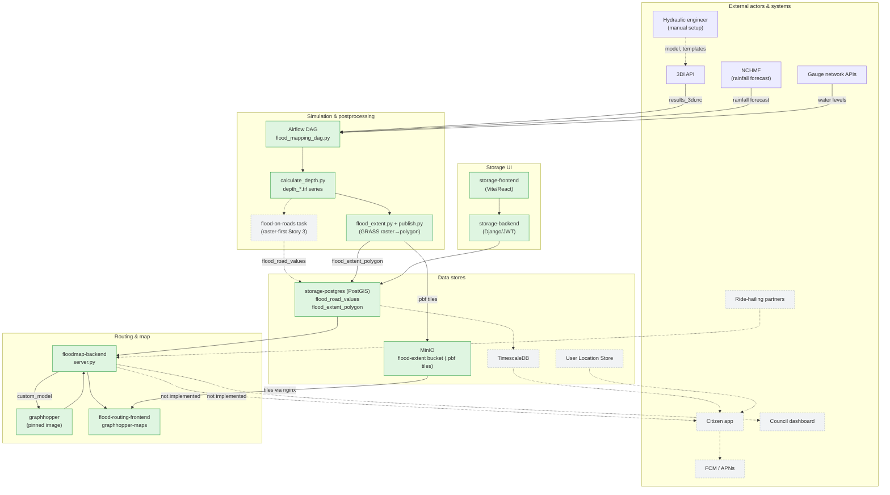

# Block diagram: T3-Digital-Twin architecture

Companion diagram for `artifacts/raw/T3-Digital-Twin_Architecture.md`, section 3 (Container
diagram). Kept as its own page because `raw/` is read-only source material this page doesn't edit.
Solid, filled boxes are Built; dashed, grey boxes are Designed, not built. Dotted arrows lead into or
between undesigned-but-unbuilt components.

The flood-on-roads node is Designed, not built. The GeoJSON chain that used to write
`flood_road_values` (`scripts/mapping/extract_geojson_full.py` through
`scripts/database/geojson_to_pg.py`) left `dags/flood_mapping_dag.py` on 2026-09-24. Until Story 3 of
[[raster-first-pipeline-stories]] lands, no DAG task writes `flood_road_values`, although
`floodmap-backend` still reads it for routing. The plan is [[raster-first-flood-pipeline]].
