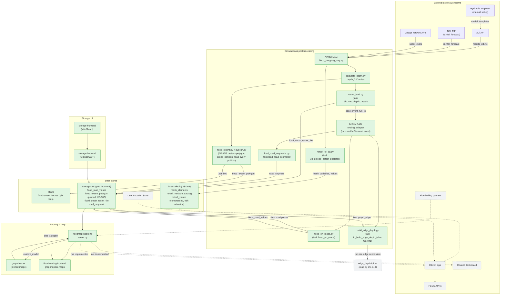

# Block diagram: T3-Digital-Twin architecture

Companion diagram for `artifacts/raw/T3-Digital-Twin_Architecture.md`, section 3 (Container
diagram). Kept as its own page because `raw/` is read-only source material this page doesn't edit.
Solid, filled boxes are Built; dashed, grey boxes are Designed, not built. Dotted arrows lead into or
between undesigned-but-unbuilt components.

The GeoJSON chain that used to write `flood_road_values` (`scripts/mapping/extract_geojson_full.py`
through `scripts/database/geojson_to_pg.py`) left `dags/flood_mapping_dag.py` on 2026-09-24. On
2026-09-25 the DAG task `flood_on_roads` took over as the writer. It reads the run's tiles from
`flood_depth_raster_tile` and the road pieces from `road_segment`. Since 2026-10-07 it runs in the
DAG `routing_adapter`, after `load_road_segments`, on the asset event of `9b_load_depth_raster`
(commit `77169c3` on the branch `modular`, not yet deployed). Each row's `depth` is the deepest 1 m sample along
a road piece, as D-006 in [[decision-log]] records. `floodmap-backend` reads `flood_road_values` for
routing, as before. The road loader and flood-on-roads nodes are marked Built because their code is
in the DAG, but neither task has run on the server yet. The plan is [[raster-first-flood-pipeline]].

TimescaleDB moved from Designed to Built on 2026-10-05 ([[netcdf-values-storage-redesign]],
`US-066`). The DAG's `3b_upload_netcdf_postgres` task (`netcdf_to_pg.py`) runs in parallel with
`3_calculate_depth`, not downstream of it — both depend only on `2_download_results` and
`0b_ensure_schema` finishing, per `dags/flood_mapping_dag.py`'s task graph. It writes the
deduplicated mesh geometry and variable catalog (`mesh_elements`, `netcdf_variable_catalog`) and
the per-timestep values onto a `netcdf_values` hypertable with a 6-hour compression policy and a
48-hour retention policy, replacing a same-named table on `storage-postgres` that had no retention
at all and reached 56 GB during a 48-hour soak test ([[docker-data-vhdx-fills-c-drive-again]]). That
old table is dropped. The dotted `PG -.-> TSDB` edge from the earlier diagram is gone with it: the
DAG writes to TimescaleDB directly, never through `storage-postgres`. `flood_extent_polygon` on
`storage-postgres` also got an automated prune the same week ([[prune-flood-extent-polygon-rows]],
`US-067`), the other table the same incident found growing unbounded.
