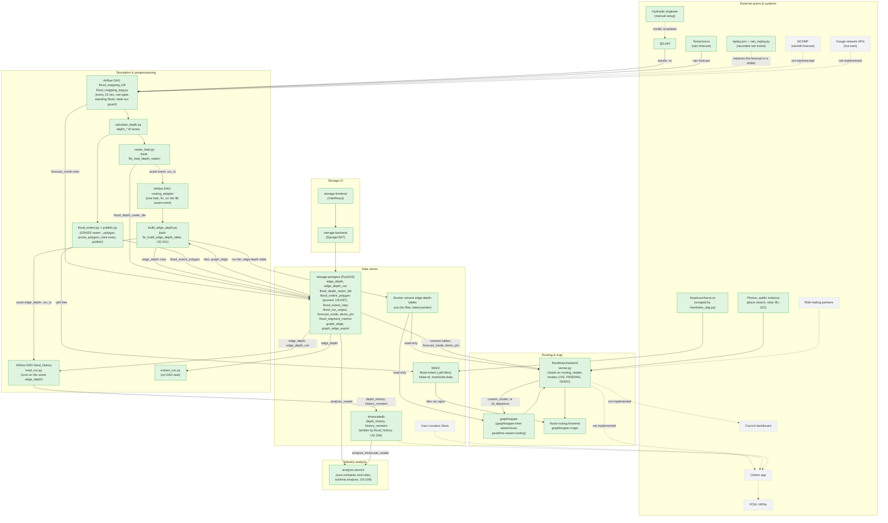

# Block diagram: T3-Digital-Twin architecture

Companion diagram for `artifacts/raw/T3-Digital-Twin_Architecture.md`, section 3 (Container
diagram). Synced with the code on the branch `modular` on 2026-10-13, after [[US-123-delete-flood-on-roads-and-flood-road-values|US-123]] and [[US-140-delete-the-postgis-input-of-the-flood-tile-build|US-140]]. Solid, filled
boxes are Built. Dashed, grey boxes are Designed, not built. Dotted arrows lead into or between
components that are not built. The box `extract_run.py` is Built, not scheduled: no DAG task calls it.

The per-piece sampler, the task `flood_on_roads` and its table `flood_road_values`, ran from 2026-09-25 until
[[US-123-delete-flood-on-roads-and-flood-road-values|US-123]] deleted it on 2026-10-13 ([[decision-log|D-038]]).
The task `9c_build_edge_depth_table` of the DAG `routing_adapter` now writes the edge depth file and the `edge_depth` rows,
and it runs on the asset event of `9b_load_depth_raster`. `floodmap-backend` reads `edge_depth` and `graph_edge` for the
map overlay and the route fallback, and the engine reads the files. The plan was [[raster-first-flood-pipeline]].

The `graphhopper` service builds from `java/time-aware-routing` and reads the edge depth files from the
volume `edge-depth-tables`. `floodmap-backend` mounts the same volume read-only and sends a departure to the engine
when `TIME_AWARE_ROUTING` is on. The flag is on since 2026-10-12 ([[decision-log|D-034]]). In `DEMO` mode the route skips
the engine and reads the pinned step through the flood areas ([[decision-log|D-043]]). Task `9c` took 24 s on the real runs
of 2026-10-13, and a run took 148 s from `3_calculate_depth` to the end of the chain ([[US-045-prove-the-table-on-the-server|US-045]],
[[US-123-delete-flood-on-roads-and-flood-road-values|US-123]]). The decision record for the engine is ADR-008 in the architecture document.

`flood_mapping_full` writes one row of `forecast_mode` for each slot (`LIVE`, `PENDING`, or `DEMO`), and `demo_pin` holds the
one step of the stored storm that `DEMO` shows. `GET /flood/mode` answers the mode, and in `DEMO` the point read, the flood areas,
and the route use the pinned run ([[US-111-show-a-pinned-demo-flood-when-no-rain-is-forecast|US-111]], [[US-129-pin-the-peak-step-of-the-demo-flood|US-129]],
[[US-130-serve-the-forecast-mode-and-read-the-pinned-step|US-130]], [[decision-log|D-030]]). The DAG skips a run whose slot is older than
two hours, so an unpause cannot revive old work ([[US-139-skip-a-flood-run-whose-slot-is-hours-old|US-139]]).

The DAG `flood_history` copies each run from `edge_depth` into the TimescaleDB tables `depth_history` and `history_moment`, and the
`analysis` service reads both databases through its own read-only roles and writes only its schema `analysis`
([[timescaledb-schema]], [[analysis-service]]). The pipeline tables stay in schema `public` ([[decision-log|D-049]]).

TimescaleDB moved from Designed to Built on 2026-10-05 ([[US-066-netcdf-values-storage-redesign|netcdf-values-storage-redesign]],
`US-066`), with a `netcdf_values` hypertable that task `3b_upload_netcdf_postgres` filled. On 2026-10-10 the ingest was retired ([[US-095-retire-the-netcdf-values-ingest|US-095]], D-018, D-022): the task, its scripts, and the tables `netcdf_values`, `netcdf_variable_catalog`, and `mesh_elements` are gone, and so are the three `storage-postgres` netcdf tables. `timescaledb` holds four tables: `depth_history` and `history_moment`, which the DAG `flood_history` fills, and `institution_histogram_bar` and `background_forecast_depth`, which stay empty (D-009). `flood_extent_polygon` on
`storage-postgres` also got an automated prune the same week ([[US-067-prune-flood-extent-polygon-rows|prune-flood-extent-polygon-rows]],
`US-067`), the other table the same incident found growing unbounded.
