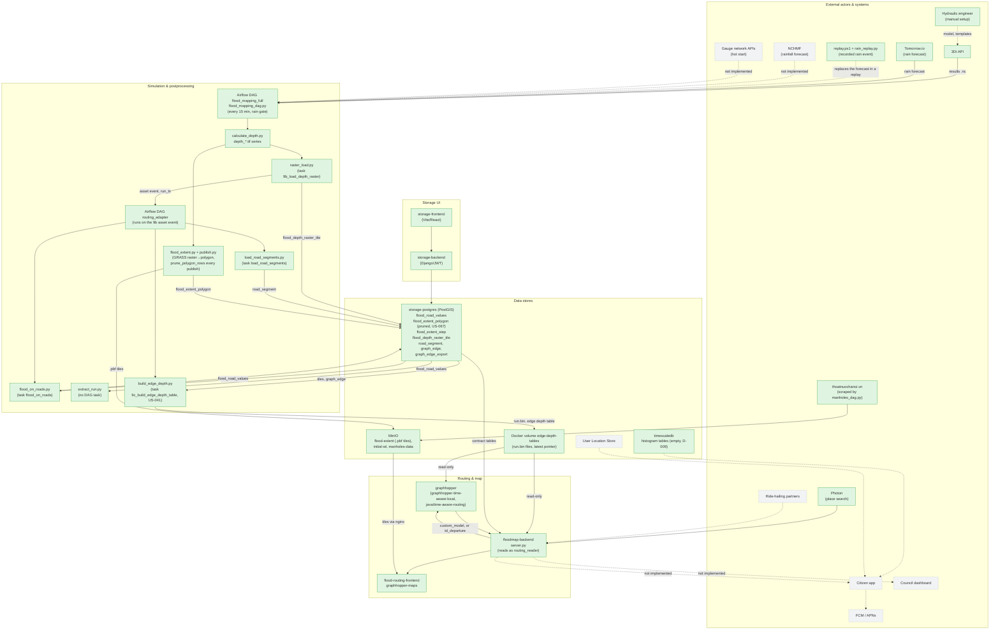

# Block diagram: T3-Digital-Twin architecture

Companion diagram for `artifacts/raw/T3-Digital-Twin_Architecture.md`, section 3 (Container
diagram). Synced with the code at commit `db99bc1` on the branch `modular` on 2026-10-08. Solid, filled
boxes are Built. Dashed, grey boxes are Designed, not built. Dotted arrows lead into or between
components that are not built. The box `extract_run.py` is Built, not scheduled: no DAG task calls it.

The GeoJSON chain that used to write `flood_road_values` (`scripts/mapping/extract_geojson_full.py`
through `scripts/database/geojson_to_pg.py`) left `dags/flood_mapping_dag.py` on 2026-09-24, and the
scripts were deleted on 2026-09-29. On 2026-09-25 the DAG task `flood_on_roads` took over as the
writer. It reads the run's tiles from `flood_depth_raster_tile` and the road pieces from
`road_segment`. Since 2026-10-07 it runs in the DAG `routing_adapter`, after `load_road_segments`,
on the asset event of `9b_load_depth_raster` (commit `77169c3` on the branch `modular`). `routing_adapter`
runs on the server and is unpaused there (checked 2026-10-08). Each row's `depth` is the deepest 1 m sample along a road piece, as D-006
in [[decision-log]] records. `floodmap-backend` reads `flood_road_values` for routing, as before. The
plan is [[raster-first-flood-pipeline]].

The `graphhopper` service builds from `java/time-aware-routing` and reads the edge depth files from the
volume `edge-depth-tables`. `floodmap-backend` mounts the same volume read-only and sends a
departure to the engine only when `TIME_AWARE_ROUTING` is on. The engine was deployed and tested on the
server on 2026-10-07 (`US-055`). `scripts/routing_proof/rollout.ps1` turns the flag on for the proof and
puts it back off unless run with `-LeaveOn`. At rest on 2026-10-08 the backend reads
`TIME_AWARE_ROUTING=false`, so ordinary live routing is still single-timestep. Whether `-LeaveOn` was
used is unconfirmed. `US-045` (live timing of task 9c) is still open. The decision record for the engine is
ADR-008 in the architecture document.

TimescaleDB moved from Designed to Built on 2026-10-05 ([[US-066-netcdf-values-storage-redesign|netcdf-values-storage-redesign]],
`US-066`), with a `netcdf_values` hypertable that task `3b_upload_netcdf_postgres` filled. On 2026-10-10 the ingest was retired ([[US-095-retire-the-netcdf-values-ingest|US-095]], D-018, D-022): the task, its scripts, and the tables `netcdf_values`, `netcdf_variable_catalog`, and `mesh_elements` are gone, and so are the three `storage-postgres` netcdf tables. `timescaledb` keeps only the three empty histogram tables. `flood_extent_polygon` on
`storage-postgres` also got an automated prune the same week ([[US-067-prune-flood-extent-polygon-rows|prune-flood-extent-polygon-rows]],
`US-067`), the other table the same incident found growing unbounded.
