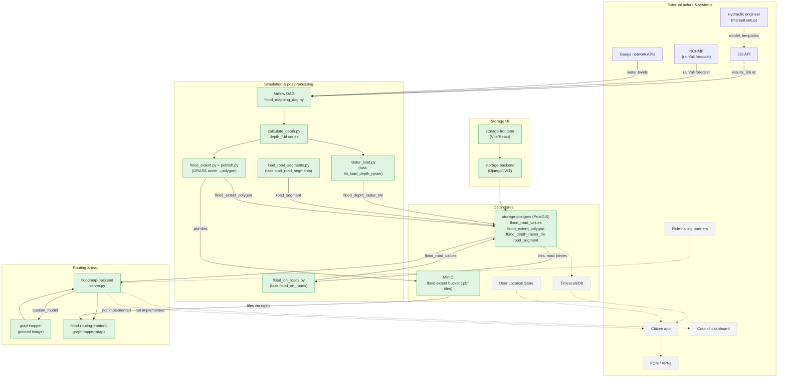

# Block diagram: T3-Digital-Twin architecture

Companion diagram for `artifacts/raw/T3-Digital-Twin_Architecture.md`, section 3 (Container
diagram). Kept as its own page because `raw/` is read-only source material this page doesn't edit.
Solid, filled boxes are Built; dashed, grey boxes are Designed, not built. Dotted arrows lead into or
between undesigned-but-unbuilt components.

The GeoJSON chain that used to write `flood_road_values` (`scripts/mapping/extract_geojson_full.py`
through `scripts/database/geojson_to_pg.py`) left `dags/flood_mapping_dag.py` on 2026-09-24. On
2026-09-25 the DAG task `flood_on_roads` took over as the writer. It reads the run's tiles from
`flood_depth_raster_tile` and the road pieces from `road_segment`, and runs after
`9b_load_depth_raster` and `load_road_segments`. Each row's `depth` is the deepest 1 m sample along
a road piece, as D-006 in [[decision-log]] records. `floodmap-backend` reads `flood_road_values` for
routing, as before. The road loader and flood-on-roads nodes are marked Built because their code is
in the DAG, but neither task has run on the server yet. The plan is [[raster-first-flood-pipeline]].
