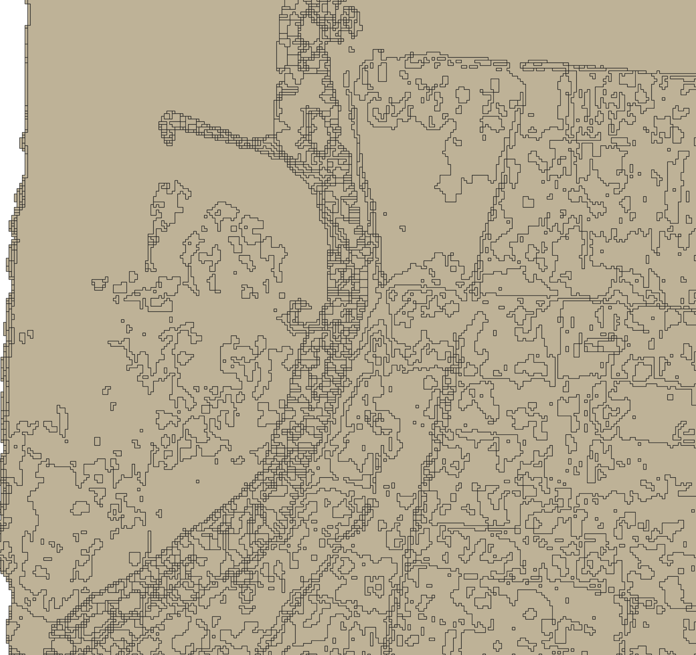
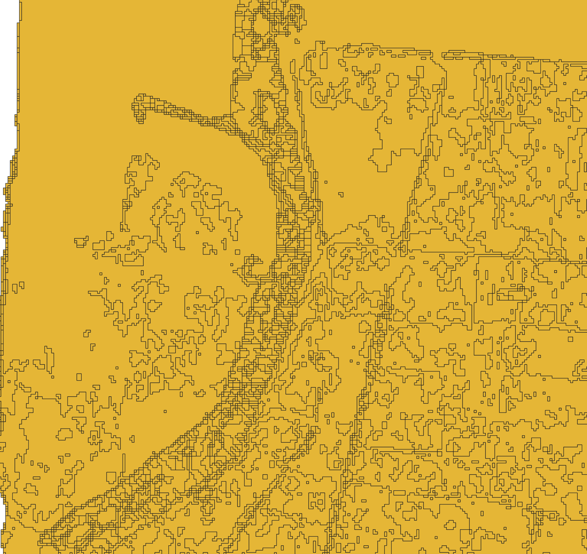
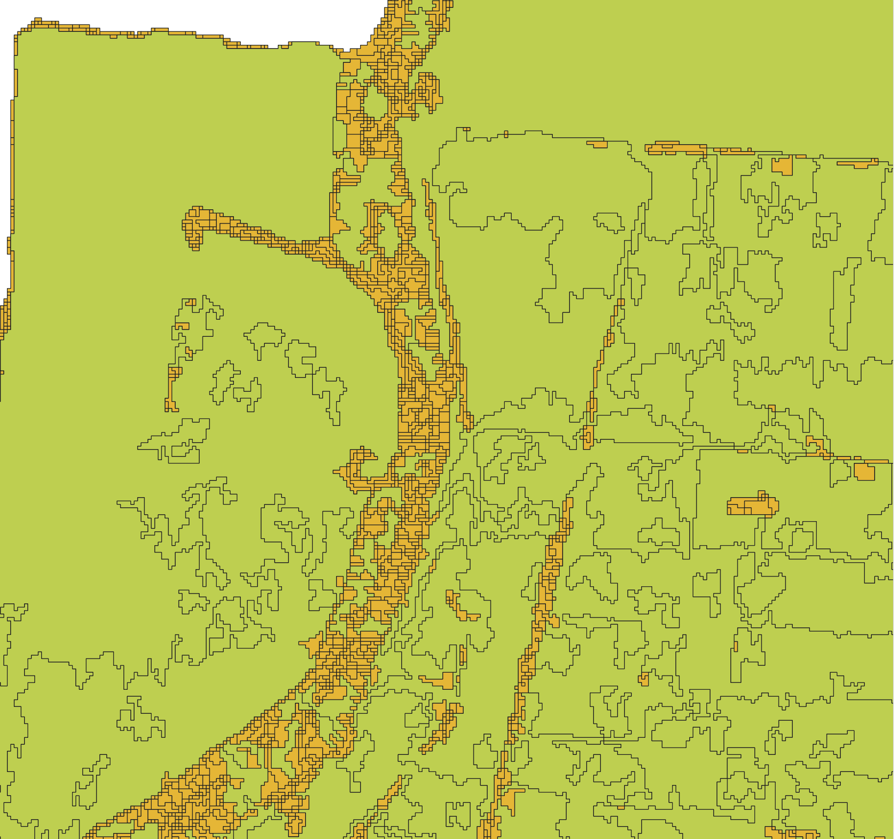
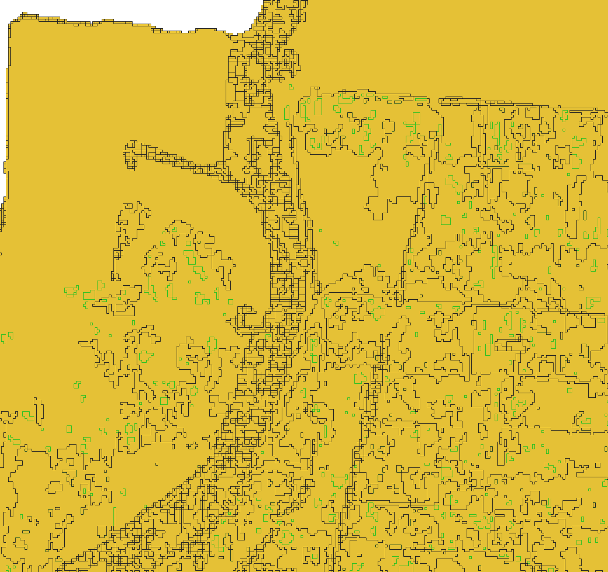
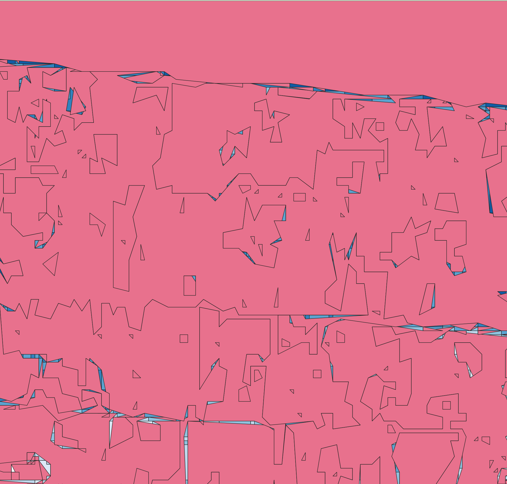

# How to vectorize a flood-depth GeoTIFF in QGIS

This guide turns one timestep of the flood-depth raster into a smooth polygon
extent, the way the UK Environment Agency's "Flood map for planning" renders
flood zones. Use it to test whether a vector extent looks better than the raw
per-pixel raster before building that pipeline into the app.

Tested against `depth_20260809_202000.tif`, one of the sparse test timesteps
(1,424 of 56,000,056 pixels above the 1 cm display floor). Any single-timestep
depth GeoTIFF from `grasshopper-routing/flood-timeseries/` works the same way.

## Before you start

You need QGIS 3.x with the GDAL and SAGA processing providers enabled (both
ship with the standard QGIS install). Open the Processing Toolbox panel
(**Processing > Toolbox**) before step 3.

## Load the raster

1. Go to **Layer > Add Layer > Add Raster Layer**.
2. Select the `.tif` file, for example `depth_20260809_202000.tif`.
3. Click **Add**.

The layer loads with a default grayscale style. Most of the raster is 0
(dry), so the layer looks almost empty. That's expected.

## Build a wet/dry mask

Threshold the raster to a binary mask at your display floor.

1. Go to **Raster > Raster Calculator**.
2. Set the expression to `"depth_20260809_202000@1" >= 0.01`, using your
   layer's actual name in place of `depth_20260809_202000`. This matches the
   1 cm floor `color_for_depth()` uses in `tiles.py`.
3. Set **Output layer** to a new file, for example `wet_mask.tif`.
4. Click **OK**.

The output raster has 1 where depth is at least 1 cm, and 0 everywhere else.

If you want depth bands instead of one wet/dry mask, use **Raster > Analysis

```Python
processing.run("native:reclassifybytable", {'INPUT_RASTER':'/private/var/folders/yc/px92hv2x51j73z7gk2hsjb1w0000gn/T/processing_HnexoK/6822f61e353d441884a865de19c98d55/OUTPUT.tif','RASTER_BAND':1,'TABLE':['0','0.05','0'],'NO_DATA':-9999,'RANGE_BOUNDARIES':0,'NODATA_FOR_MISSING':False,'DATA_TYPE':5,'CREATION_OPTIONS':None,'OUTPUT':'TEMPORARY_OUTPUT'})
processing.run("native:reclassifybytable", {'INPUT_RASTER':'/Users/maianhtran/Documents/3Di/Case-study-sim-center/test-code/Test event/recreate event 20251007/depth-analysis/depth_event20251007_Ver03_rain-csv/depth_event20251007_Ver03.tif','RASTER_BAND':1,'TABLE':['0.05','0.1','10','0.1','0.2','20','0.2','0.3','30','0.3','0.4','40','0.4','0.5','50','0.5','0.6','60','0.6','10','600'],'NO_DATA':-9999,'RANGE_BOUNDARIES':0,'NODATA_FOR_MISSING':False,'DATA_TYPE':5,'CREATION_OPTIONS':None,'OUTPUT':'TEMPORARY_OUTPUT'})
```

> Reclassify by Table** instead, with breakpoints at 0.01, 0.05, 0.10, 0.30,
> and 0.60, matching `DISPLAY_DEPTH_BANDS_CM` in `tiles.py`.

## Close the mask

This step merges isolated wet pixels into contiguous blobs. Skip it only if
you want to see the raw, unmerged pixel pattern first for comparison.

1. In the Processing Toolbox, search for **Morphological Filter** under the
   SAGA provider.
2. Set **Input** to `wet_mask.tif`.
3. Set **Method** to **Closing**.
4. Set **Radius** to 3-5 cells (3-5 m at this raster's 1 m resolution). Start
   at 3 and raise it if isolated cells still don't merge.
5. Click **Run**.

If SAGA isn't available, use the GRASS provider instead. The GRASS steps work
on the depth-band raster, `re-classify_depth.tif`, instead of the binary mask,
so the polygons keep their depth bands. In that raster, dry cells are nodata
and cells with a depth under 5 cm are 0.

`r.grow.distance` computes the distance to the nearest wet cell for every cell
in the raster, so it has no radius. Run it alone and it fills the whole
raster, not just the cells near existing wet pixels. Bound it with `r.mapcalc`
on both the grow and the shrink step, using the GRASS Console or **Processing >
GRASS GIS**. The steps call the band raster `depth_bands`.

1. Run `r.mapcalc "wet_bands = if(depth_bands > 0, int(depth_bands), null())"`
   to keep only the wet cells. This drops the 0 cells, because
   `r.grow.distance` treats every cell that isn't null as wet.
2. Run `r.grow.distance input=wet_bands distance=dist1 value=val1` to get the
   distance to, and the depth band of, the nearest wet cell for every cell.
3. Run `r.mapcalc "dilated = if(!isnull(wet_bands), wet_bands, if(dist1 <= 8, int(val1), null()))"` to grow the bands by 8 cells (8 m at this raster's 1 m resolution). Each new cell takes the band of its nearest wet cell. Raise the `8` if isolated
   cells still don't merge.
4. Run `r.mapcalc "inv = if(isnull(dilated), 1, null())"` to invert the
   grown bands.
5. Run `r.grow.distance input=inv distance=dist2` to get, for every cell,
   the distance to the nearest cell that's still empty after the grow.
6. Run `r.mapcalc "closed = if(dist2 <= 8, null(), dilated)"` to shrink the
   bands back by the same distance you grew them in step 3.
7. Run `r.mapcalc "final = if(!isnull(closed), closed, if(depth_bands == 0, 0, null()))"` to put back the 0 cells that closing didn't cover.

To run the same seven steps from the QGIS Python Console, use the following
code. Set `RADIUS` to the value you use in steps 3 and 6, and `depth_bands` to
the path of your band raster.

```Python
RADIUS = 8
depth_bands = '/Users/maianhtran/Documents/3Di/Case-study-sim-center/airflow_clone/t3-digital-twin/artifacts/docs/re-classify_depth.tif'
final_path = '/Users/maianhtran/Documents/3Di/Case-study-sim-center/airflow_clone/t3-digital-twin/artifacts/docs/grass_close-the-mask.tif'
region = {'GRASS_REGION_PARAMETER': None, 'GRASS_REGION_CELLSIZE_PARAMETER': 0, 'GRASS_RASTER_FORMAT_OPT': '', 'GRASS_RASTER_FORMAT_META': ''}

# Step 1: keep only the wet cells (A = depth_bands)
wet = processing.run("grass:r.mapcalc.simple", {'a': depth_bands, 'expression': 'if(A > 0, int(A), null())', 'output': 'TEMPORARY_OUTPUT', **region})

# Step 2: distance to, and depth band of, the nearest wet cell
grow1 = processing.run("grass:r.grow.distance", {'input': wet['output'], 'metric': 0, '-m': False, '-n': False, 'distance': 'TEMPORARY_OUTPUT', 'value': 'TEMPORARY_OUTPUT', **region})

# Step 3: grow the bands by RADIUS cells (A = wet_bands, B = dist1, C = val1)
dilated = processing.run("grass:r.mapcalc.simple", {'a': wet['output'], 'b': grow1['distance'], 'c': grow1['value'], 'expression': f'if(!isnull(A), A, if(B <= {RADIUS}, int(C), null()))', 'output': 'TEMPORARY_OUTPUT', **region})

# Step 4: invert the grown bands (A = dilated)
inv = processing.run("grass:r.mapcalc.simple", {'a': dilated['output'], 'expression': 'if(isnull(A), 1, null())', 'output': 'TEMPORARY_OUTPUT', **region})

# Step 5: distance to the nearest cell that is still empty after the grow
grow2 = processing.run("grass:r.grow.distance", {'input': inv['output'], 'metric': 0, '-m': False, '-n': False, 'distance': 'TEMPORARY_OUTPUT', 'value': 'TEMPORARY_OUTPUT', **region})

# Step 6: shrink the bands back by RADIUS cells (A = dilated, B = dist2)
closed = processing.run("grass:r.mapcalc.simple", {'a': dilated['output'], 'b': grow2['distance'], 'expression': f'if(B <= {RADIUS}, null(), A)', 'output': 'TEMPORARY_OUTPUT', **region})

# Step 7: put back the 0 cells that closing didn't cover (A = closed, B = depth_bands)
processing.run("grass:r.mapcalc.simple", {'a': closed['output'], 'b': depth_bands, 'expression': 'if(!isnull(A), A, if(B == 0, 0, null()))', 'output': final_path, **region})
```

Use `final` as the input to the next step. In the Python version, that's
`grass_close-the-mask.tif`.

## Convert the mask to polygons

1. Go to **Raster > Conversion > Polygonize (Raster to Vector)**.
2. Set **Input layer** to the closed mask from the previous step.
3. Check **8-connectedness**. This merges diagonally touching wet pixels into
   one polygon feature instead of leaving them as separate shapes.
4. Click **Run**.

The output vector layer has a `DN` field. After the GRASS steps, `DN` holds the
depth band: 0 for depths under 5 cm, 10 to 60 for the bands up to 60 cm, and
600 for depths of 60 cm or more. Nodata cells produce no polygon. If you closed
the binary mask with SAGA, `DN` is 1 for wet polygons and 0 for the dry
background.

```Python
processing.run("gdal:polygonize", {'INPUT':'/Users/maianhtran/Documents/3Di/Case-study-sim-center/airflow_clone/t3-digital-twin/artifacts/docs/grass_close-the-mask.tif','BAND':1,'FIELD':'DN','EIGHT_CONNECTEDNESS':True,'EXTRA':'','OUTPUT':'TEMPORARY_OUTPUT'})
```

## Keep only the wet polygons

1. Select the polygonized layer.
2. Open the attribute table and filter or select by expression: `"DN" > 0`.
3. Go to **Edit > Copy Features**, then paste into a new layer, or use
   **Export > Save Selected Features As**.

## Smooth the edges

Raw polygonized pixels have stair-step edges. Smooth them in two passes.

1. Go to **Vector > Geometry Tools > Simplify**.
2. Set **Method** to **Distance (Douglas-Peucker)**.
3. Set **Tolerance** to 1-2 times your pixel size (1-2 m for this raster).
4. Run it, then go to **Vector > Geometry Tools > Smooth**.
5. Set **Iterations** to 2-3 and **Offset** to 0.25.
6. Run it.

If nearby blobs still look disconnected after closing, buffer the layer
outward a few meters, then buffer the result inward by the same distance.
This merges nearby shapes without growing the overall extent, the same way
the raster closing pass in step 3 does, but in vector space.

## Style the layer

1. Open the layer's properties and go to **Symbology**.
2. Set the fill to a semi-transparent blue, matching `d3` from
   `DISPLAY_DEPTH_BANDS_CM` (`rgb(93, 154, 217)`) at reduced opacity.
3. Set the stroke to none, or a thin darker blue.

If you reclassified into depth bands instead of a single mask, use a
**Categorized** renderer on the `DN` field, with one color per band matching
`DISPLAY_DEPTH_BANDS_CM`.

## Compare against the raw raster

Load `wet_mask.tif` (or the original depth raster) alongside the final vector
layer and toggle between them. Check whether the vector shape still traces
real terrain features, such as a river channel, or whether smoothing merged
areas that shouldn't be connected.

## Export

If the vector result looks right, export it for later use in the app.

1. Right-click the layer and select **Export > Save Features As**.
2. Set **Format** to `GeoJSON`.
3. Click **OK**.

This GeoJSON is the same shape the app would need if you decide to serve a
vector flood-extent layer instead of the current PNG tiles.

# Current state 20260920

## After polygonize



File: /Users/maianhtran/Documents/3Di/Case-study-sim-center/airflow_clone/t3-digital-twin/artifacts/docs/experiment_depth-raster-geojson-polygon/poly.gpkg 

## After dissolve



## Delete holes

### Option 1: Min area 30 sqm

If the min area for delete holes are **30 sqm** then it **deletes a lot of the value**, the yellow is the old one, the green is the new one. See that the green miss an entire strip of the yellow, which value was 30cm.



### Option 2: 25 sqm

The green line that is highlighted are the one that will be deleted. But this option also delete a lot of values in other ares



### Option 3: 20 sqm 

Safest option

## Simplify

Make the polygon become pointy? 


