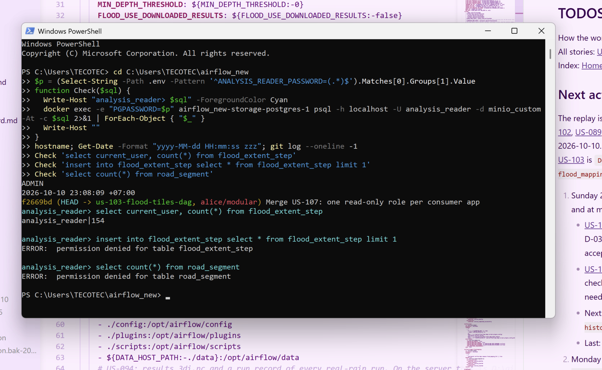

# US-107 Create a read-only role for any consumer app

As a developer of a new consumer application, I want my own read-only database role, so my application reads the contract tables it needs and nothing else.

`scripts/database/create_routing_reader_role.py` makes one role, `routing_reader`, with `SELECT` on every table of the contract page.
Change it to take a role name and read that role's table list from a section of `core-output-contract.md`.
The section names each role and its tables.
`routing_reader` keeps the same tables as today, so `floodmap-backend` does not change.
A second role, `analysis_reader`, is added to the page and gets the tables an analysis reads.
The password of each role comes from its own variable in `.env`.
`routing_reader` reads `ROUTING_READER_USER` (default `routing_reader`) and `ROUTING_READER_PASSWORD`, as in `.env.example`.
`analysis_reader` reads `ANALYSIS_READER_USER` (optional, default `analysis_reader`) and `ANALYSIS_READER_PASSWORD`.
The product owner sets `ANALYSIS_READER_PASSWORD` in the server `.env`.

Given the script run on the server for both roles, when a session connects as `analysis_reader`, then `SELECT` works on its tables, an `INSERT` fails with a permission error, and a `SELECT` on `road_segment`, which is not in its list, fails with a permission error.
Given the same run, then `floodmap-backend` still answers `POST /route` as `routing_reader`, and `test_reader_role.py` passes for both roles.

Dependencies: None.

## Status history

- **2026-10-10, draft.** Ready: it passes the INVEST check.
- **2026-10-10, In progress.** The product owner chose the password variable of the second role, `ANALYSIS_READER_PASSWORD`, and the optional user variable `ANALYSIS_READER_USER`.
- **2026-10-10, Reviewed.** The server check passed.
  The role script ran for both roles, the permission checks and `test_reader_role.py` passed, and `POST /route` returned 200.
  The product owner accepts `Done` at the review.

## Evidence and details

The server check ran on 2026-10-10 in a PowerShell session on the server.
The screenshot shows the three permission checks as `analysis_reader`, and the details list the other checks, which the screenshot does not show.

1. The server checked out the merge commit "Merge US-107: one read-only role per consumer app" on the branch `us-103-flood-tiles-dag`, and it fast-forwarded that branch to `alice/modular`.
2. The screenshot time is 2026-10-10 23:08:09 +07:00.
3. The role script ran for both roles.
   `routing_reader` reads 5 tables, and `analysis_reader` reads 4: `flood_depth_raster_tile`, `flood_extent_polygon`, `flood_extent_step`, and `flood_road_values`.
4. The script ran inside the Airflow scheduler container.
   That container does not mount `floodmap/` or `artifacts/`, so the needed files were copied to `/tmp` first.
5. As `analysis_reader`, a `SELECT` on `flood_extent_step` returned 154 rows.
6. As `analysis_reader`, an `INSERT` into `flood_extent_step` failed with `permission denied for table flood_extent_step`.
7. As `analysis_reader`, a `SELECT` on `road_segment` failed with `permission denied for table road_segment`.
8. `test_reader_role.py` passed for both roles.
   For `analysis_reader`, it also refused a read of `graph_edge`, which is not on that role's list.
9. `POST /route` on `floodmap-backend` returned 200 for the truck pair `21.0250, 105.7550` to `21.0255, 105.7620`, given latitude first.
   The backend connects as `routing_reader`, so this check covers that role.
