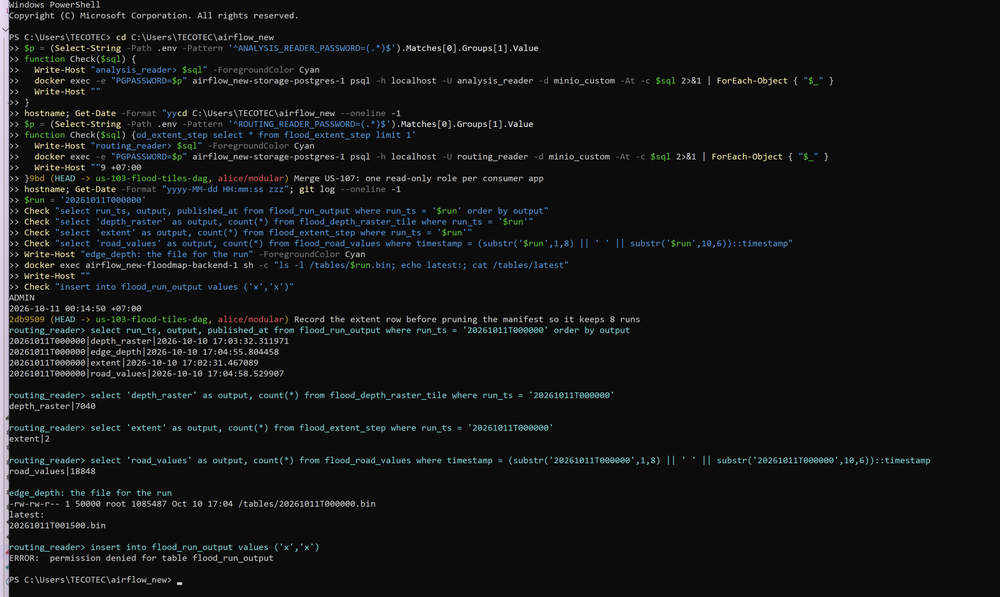

# US-108 Publish a run manifest for the core outputs

As a developer of a consumer outside Airflow, I want one table that says which outputs of a run are published, so I do not poll three places to learn that a run is ready.

A new table `flood_run_output` in `storage-postgres` has one row per run and output: `run_ts`, `output`, and `published_at`.
The primary key is (`run_ts`, `output`).
The outputs are `depth_raster` (task `9b_load_depth_raster`), `extent` (task `9_build_flood_tiles`, after its last tile step), `road_values` (task `flood_on_roads`), and `edge_depth` (task `9c_build_edge_depth_table`).
Each writer inserts its row last, in the same transaction as its data where the output is a table, and after the file rename for the edge depth file.
The table gets a column table and a retention line on `core-output-contract.md`, so `test_core_contract.py` covers it, and the same retention as the run tables (newest 8 runs).

Given a replay run on the server, when all four tasks end, then `flood_run_output` has four rows for that `run_ts`, and for each row the data it names is present: a count query on the matching table or the file named by `latest` shows it.
Given a task that fails, then its row does not exist for that run.
Given the same run loaded again, then no row is duplicated.
Given a session as `routing_reader`, then `SELECT` on the table works.

Dependencies: None. `US-107` adds the table to the list of each role.

## Status history

- **2026-10-10, draft.** Ready: it passes the INVEST check.
- **2026-10-10, In progress.** The product owner moved the story to In progress after the US-107 review.
- **2026-10-11, Reviewed.** The server check passed.
  Run `20261011T000000` wrote its four rows.
  The product owner accepts `Done` at the review.

## Evidence and details

The server check ran on 2026-10-11 in a PowerShell session on the server.
The screenshot shows the four rows of run `20261011T000000`, the data checks for that run, and a refused `INSERT`, all as `routing_reader`.

1. The server ran the branch `us-103-flood-tiles-dag`, which was fast-forwarded to `alice/modular` at the commit "Record the extent row before pruning the manifest so it keeps 8 runs".
2. The table was created with `scripts/database/create_flood_run_output_table.py` inside the Airflow scheduler container.
   The role script ran again for `routing_reader` and `analysis_reader`, so both roles read `flood_run_output`.
3. The replay of `scripts/rain_events/constant_5mm_2h.csv` with gate 5 started on 2026-10-11 at 00:30 +07.
   It was restarted for this check.
4. Run `20261011T000000` wrote four rows.
   Their `published_at` values in UTC are `extent` at 17:02:31, `depth_raster` at 17:03:32, `edge_depth` at 17:04:55, and `road_values` at 17:04:58, all on 2026-10-10.
5. As `routing_reader`, the data of the run is present.
   `flood_depth_raster_tile` has 7040 rows for `run_ts` `20261011T000000`.
   `flood_extent_step` has 2 rows for that run.
   `flood_road_values` has 18848 rows for `timestamp` `2026-10-11 00:00:00`.
6. The file `/tables/20261011T000000.bin` exists in the `floodmap-backend` container and is 1,085,487 bytes.
   At the time of the screenshot, `latest` named `20261011T001500.bin`, a newer run.
   The run's own file is therefore checked by its name, not through `latest`.
7. As `routing_reader`, an `INSERT` into `flood_run_output` failed with `permission denied for table flood_run_output`.
8. Not checked on the server: a failed task leaves no row, and a reload adds no duplicate.
   Offline tests in `scripts/database/test_run_output.py` cover both, and the primary key (`run_ts`, `output`) with the upsert in `run_output.record` keeps one row per output.
9. Offline tests on the Mac passed, apart from 10 failures in `test/test_flood_rain_gate.py` and `test/test_threedi_auth_alert.py`.
   Those failures come from a `threedi_api_client` version mismatch on the Mac, and the base commit has the same failures.
10. The concept page [[core-output-contract]] was updated on 2026-10-11.
    Its writer and retention lines for `flood_run_output` no longer mark the story as pending.
